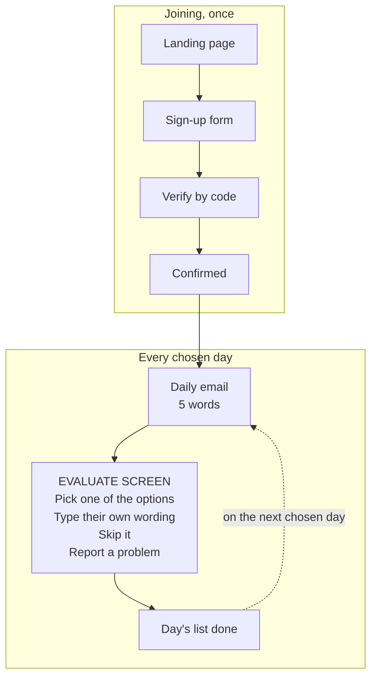

# SHOLA — front-end and user-facing documentation

Prepared in response to a request for user flow diagrams, wireframes, user
story maps and target user profiles.

## What exists, and what does not

SHOLA has no Figma files, no wireframes and no user story map, because the
interface was never designed in a prototyping tool. It was designed directly in
HTML and CSS, and the running site has been the only artefact throughout.

That is a real answer rather than a gap being covered over. A two-person team
building a volunteer tool found that a mockup of a screen and the screen itself
cost about the same to produce, and only one of them can be used by a speaker in
Accra on a phone.

What does exist, and what this document sets out:

- **A target user profile**, from the constraints the volunteers actually work under
- **The complete user journey**, from first visit to answering words daily
- **Every screen**, mapped to the template file that renders it
- **The design constraints** that shaped the interface, and why each was chosen
- **The copy standards** the interface text follows

Where a conventional project would point at a prototype, this one points at
source. Every screen named below is a file in this repository, and the live site
can be opened and used without an account.

## Who SHOLA is for

The user is a native speaker of an African language who is not a linguist, not a
volunteer by habit, and has no particular reason to spend time on this.

That last point drove most of the design. Every assumption below is a constraint
the interface had to survive, not a persona sketch.

| Assumption | What it forced |
| --- | --- |
| On a phone, on mobile data | One column, large tap targets, no image-heavy pages, no client-side framework |
| Has no account anywhere and will not make one | No passwords, no sign-in; a signed link in an email is the only credential |
| Will give a few minutes, not an evening | 5 words per day, and a visible end to the list |
| May answer for weeks, then stop without saying so | Work is leased, not assigned; an unanswered word returns to the queue after 10 days |
| Knows the language, not the jargon | No "corpus", "annotation", "token" or "consensus" anywhere in the interface |
| May be the only speaker of their language in the system | A language works through its own queue independently of every other |

The volunteer is not the only user. Two others matter:

- **Data consumers** — researchers and developers using the public API, which
  needs no key and no sign-up
- **The administrator** — one person, reviewing reported words and nothing else;
  the admin dashboard is deliberately a single page

An important limit on all of this: SHOLA currently has 9 active volunteers and
roughly 400 answers, nearly all in Asante Twi. The design anticipates scale it
has not yet been tested at.

## The user journey

Joining happens once and takes about a minute. After that the volunteer never
visits the site unprompted: the daily email arrives on their chosen days, and
its link opens their words directly.

Three things are deliberately absent from this flow. There is no sign-in step,
because the link is the credential. There is no "submit" at the end of the list
— each answer saves as it is given, so a volunteer who stops halfway loses
nothing. And there is no way to ask for more words.

Two side routes are not drawn, to keep the loop readable. A volunteer can open
**settings** from any page to change their days, change the time, pause for a
set number of days, or leave entirely. And if the email is lost, **request a
link** sends a fresh one to the same address.

## Every screen, and the file that renders it

Thirteen public screens and ten email templates. Each row is a real file in
`shola/templates/`, so a reader can read the markup rather than a picture of it.

| Screen | Route | Template | What the user does |
| --- | --- | --- | --- |
| Landing | `/` | `index.html` | Reads what SHOLA is; decides whether to join |
| Sign-up | `/join` | `join.html` | Name, email, language, days, time of day, optional photo |
| Verify | `/verify` | `verify.html` | Enters the code emailed to them |
| Joined | `/start/<token>` | `joined.html` | Confirmation; the words start arriving |
| **Evaluate** | `/w/<token>` | `evaluate.html` | **The core screen.** Picks a translation, types their own, skips, or reports |
| Done | `/w/<token>/done` | `done.html` | Sees the list is finished for today |
| Settings | `/w/<token>/settings` | `settings.html` | Changes days or time; pauses; leaves |
| Weekly | `/w/<token>/weekly` | `weekly.html` | Reviews their own week |
| Progress | `/stats` | `stats.html` | Sees how far each language has got |
| Champions | `/champions` | `champions.html` | Sees who has contributed most |
| Model scores | `/models` | `models.html` | Compares the machine translation systems |
| API docs | `/api` | `api.html` | Finds out how to get the data out |
| Request a link | `/resend` | `resend.html` | Recovers access when the email is lost |

The interface is one screen wide. `base.html` carries the shell, and
`shola/static/css/shola.css` is the only stylesheet; there is no CSS framework
and no JavaScript framework.

### Email

Email is not a notification channel here; it is where the work starts. Each
template exists in both HTML and plain text, because a volunteer on a basic
client must get the same thing.

| Template | When it is sent |
| --- | --- |
| `otp` | At sign-up, carrying the verification code |
| `link` | When someone asks for their link again |
| `daily` | On each chosen day, carrying that day's words |
| `weekly` | A summary of the week just done |
| `opened` | When a language they can answer opens up |

## The constraints that shaped it

Five decisions account for most of what the interface looks like. Each was a
response to a constraint, not a style preference.

**No accounts, no passwords.** A signed token in a URL is the entire credential.
A volunteer clicks the link in their email and is working; there is nothing to
remember and nothing to reset. The cost is that anyone holding the link holds
the access, which is an acceptable trade for a word list — it would not be for
anything sensitive.

**Email is the product.** The daily email carries the words and a link straight
into them. The website exists for the people that email reaches. This is why
every email template exists in plain text as well as HTML.

**Five words a day, and the number is not negotiable by the user.** A volunteer
chooses *which days* and *what time*, never *how many*. A short list that visibly
ends is the thing that makes a daily habit possible; letting people opt into
fifty words produces one enthusiastic week and then silence.

**The work is leased, not assigned.** Nothing is reserved for a volunteer at
sign-up. Each day they are handed what the project needs that day, and anything
they do not answer within 10 days returns to the queue. A volunteer who stops
coming costs the project nothing.

**Nobody is asked to be certain.** An item wants 5 answers, and disagreement is
recorded rather than resolved. The interface never tells a speaker they are
wrong, and never asks them to adjudicate between other people's answers. Where
speakers disagree, that disagreement is the finding.

One consequence worth naming: because a volunteer can type their own wording,
every typed answer becomes an option the next speaker sees. The interface
therefore has no fixed number of options on screen — it grows with the
disagreement.

## How the interface is written

The copy follows standard web writing practice — user-focused, one idea per
line, no pitch. For this audience that is a functional requirement rather than a
stylistic one: many volunteers are reading in their second or third language.

The working rules:

- **Write for the person doing the task, not for a stakeholder.** Interface text
  that explains the project's importance is text the volunteer has to read past.
- **One clear line beats an accurate paragraph.** Pages that grew explanatory
  tables have had them removed.
- **No internal vocabulary.** "Group" replaced "tier", and the word "consensus"
  does not appear.
- **Say "words" carefully.** Volunteers evaluate noun phrases, not single words,
  so "items" or the project name is used where "your words" would be wrong.
- **Never make the volunteer the problem.** No copy suggests a speaker has
  answered incorrectly.

There is no separate tone-of-voice document. The rules above were applied
through review of the running interface, and the git history records each change
and its reason.

## Where to look at the real thing

The running site is the specification, and it can be inspected without
permission or an account.

| What | Where |
| --- | --- |
| The live site | [sholaproject.org](https://sholaproject.org) |
| Source code | [github.com/michsethowusu/SHOLA](https://github.com/michsethowusu/SHOLA) |
| Templates | `shola/templates/` |
| Stylesheet | `shola/static/css/shola.css` — the only one |
| Design rationale | [`README.md`](../README.md), which explains each decision and what went wrong before it |
| Media kit | [sholaproject.org/brand](https://sholaproject.org/brand) — logo, palette, typeface |

The landing, progress, champions, model scores and API pages can all be opened
directly. The evaluate screen cannot, because it sits behind a volunteer's
signed link — that is the only part of the interface a reviewer cannot reach
unaided, and we can arrange a walk-through of it.

Two things in the repository are more useful than they sound. `README.md`
documents not just what the interface does but what was tried first and why it
failed, including two outages and what they changed. And the commit history is
written in full prose, so the reasoning behind each interface change is
recoverable.

## If you need the conventional deliverables

We can produce any of these, but each would be drawn *from* the built interface
rather than having informed it. That is worth being explicit about, because a
wireframe produced after the fact documents a decision; it does not record how
the decision was made.

| Deliverable | Effort | Honest value |
| --- | --- | --- |
| Annotated screenshots of every screen | Low | High — closest thing to a wireframe set, and accurate |
| A clickable Figma file | High | Low — would be traced from the live site |
| User story map | Medium | Medium — the stories exist implicitly; writing them down may expose gaps |
| Formal personas | Low | Low — the profile above is grounded; personas would add fiction |
| Usability test findings | Medium | **Highest** — this is the real gap |

That last row is the one we would argue for. SHOLA has never been watched in use
by someone who did not build it. With 9 volunteers, three sessions would likely
surface more than any retrospective diagram.

If the interest is in how design decisions get made on a small team without a
design tool, the git history is probably the most honest material available — it
records the changes, the reasons, and the occasions when the first attempt was
wrong.
